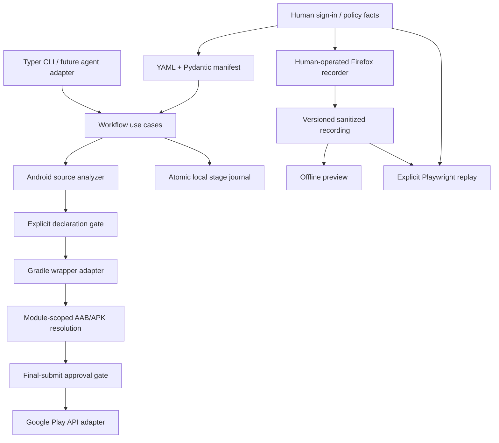

# Architecture

PlayFlow keeps the existing `src/` Python package layout. Its public configuration is independent of any LLM, cloud host, editor, or agent framework. New entry points should call shared workflow use cases rather than reproduce CLI logic.

## Modules and responsibilities

| Module | Responsibility | Boundary |
| --- | --- | --- |
| `models.py`, `config.py` | Versioned configuration, validation, safe YAML serialization | No external services |
| `analyzer.py` | Module-scoped Android XML and static Gradle inspection | Conservative source hints, not compiled artifact identity |
| `requirements.py`, `assets.py`, `readiness.py` | Versioned local validation rules, image checks, and offline preparation/testing plan | Does not certify Console completion |
| `policy.py` | Questions requiring developer input | Does not infer legal declarations from permissions |
| `workflow.py` | Inspection, gates, build, publishing orchestration | Shared by direct CLI commands and pipeline |
| `gradle.py`, `adb.py`, `shell.py` | Local subprocess adapters and artifact selection | Executes trusted local projects |
| `signing.py` | Local upload-key generation and standalone AAB signature verification | Uses JDK tools; never changes existing keys or source bundles |
| `artifacts.py` | Pinned local bundletool inspection, built package/version/modules/permissions/components and strict saved-key verification | Separate from source inspection and lightweight preflight; does not establish remote acceptance |
| `release_draft.py` | Observe and reconcile an explicit closed-release draft, upload selected bundle, save notes and verify a fresh document | No track creation, automatic resume, review submission or production promotion |
| `play_api.py` | Google edit → bundle → track → validate → commit/discard | Optional Google dependency; no interactive prompts |
| `browser.py` | Dedicated authentication profile, offline preview, explicit semantic replay | Optional browser dependency loaded only for live actions |
| `firefox.py` | Read-only legacy/profile-group discovery and existing-profile Console launch | Standard library; launch status does not verify page state |
| `state.py` | Private atomic stage journal | One writer per Android project |
| `cli.py` | Argument parsing, output, exit codes, approval UI | Delegates application behavior to `Workflow` |
| `firefox-recorder/` | Manual Console interaction recording | Separate deliverable, versioned JSON boundary |

The core installation excludes the Playwright and Google client dependencies. `browser` and `publish` extras enable their adapters. The Python wheel includes credential-free live Firefox bridge assets, which are copied into a private generated session and loaded explicitly as a temporary addon. Installing the wheel does not install an addon into Firefox. The separate manual recorder is included in the source archive.

## Workflow semantics

`run_pipeline` performs inspection, declaration checks, build, and optional publishing. `Workflow.publish` repeats the policy check and enforces final approval itself, so a different entry point cannot accidentally bypass the configured gate. The approval callback runs only after package/artifact preflight and before the Google client is constructed. Without a callback, a required commit approval blocks the operation.

`playflow build` intentionally permits a local build before policy facts are complete. `publish` validates an existing artifact; it does not silently rebuild it. Publishing status is `validated` for a discarded validation edit and `done` for a successful commit. Blocked CLI operations exit 2; command/replay failures exit 1.

`Workflow.configure_testers` uses the same final-approval policy and a separate journal stage. It can configure groups before a bundle is built or app policy answers are complete; no bundle upload occurs in that use case. `publish` merges configured groups in its existing edit. Both preserve previously configured Google Groups and verify the API response.

A non-commit API operation still creates an edit and uploads a bundle. It validates, then deletes the edit. Failures trigger best-effort edit cleanup, preserving the original error. There is no automatic retry around mutating API operations. A network failure during commit may leave the remote outcome unknown; inspect Console before another invocation.

## Configuration and artifact identity

The manifest is the stable user-facing contract. Unknown fields and schema versions fail validation; additive optional fields remain schema version 1. `schemas/play-manifest.schema.json` is generated from Pydantic models and checked in CI. Cross-field rollout rules are enforced by Pydantic at runtime as well as documented; JSON Schema alone does not express every runtime rule.

An optional `testing` configuration records closed/internal/open intent, Google Groups, and country scope independently of the actual API track identifier. A null track ID blocks remote operations; closed mode cannot fall back to internal/production. Country selection remains a Console step because the public country-availability resource is read-only.

Module names map standard Gradle paths (`mobile:app`) to source directories (`mobile/app`). Task names without a leading colon are qualified with the selected module. Explicit artifact paths take precedence; otherwise exactly one matching file must exist in that module's outputs. Modification times never choose between variants.

The analyzer uses namespace-aware XML parsing, excludes generated/dependency directories, and prefers a literal `applicationId` over an old manifest package. Namespace alone does not establish application identity. Variant suffixes, flavor blocks, conflicting IDs, and dynamic expressions require explicit `play.package_name`. The scanner is not a Gradle parser; manifest merge results and transitive SDK behavior still require review.

## State and privacy

The optional `state_dir` relocates the journal without writing to the Android source tree; it resolves relative to the manifest. Browser engine/profile preferences are explicit, and unsupported Firefox live operations fail rather than using a different engine.

State is a journal, not a scheduler or an idempotency guarantee. Each stage writes `running`, then `done`/`failed`, or records a blocked gate. Temporary files use private permissions and atomic replacement so a failed write preserves the previous complete JSON. Newly created state directories use mode 0700 and state files use 0600 on POSIX. Exception types are recorded without raw error messages or build logs.

Stage entries describe the latest attempt at each stage and may come from different invocations. They do not establish that an older completed publish belongs to the newest build. Concurrent writers, automatic stage skipping, artifact provenance, and restartable remote transactions require a future versioned run model rather than interpreting old entries as a resume plan.

The recorder removes queries/fragments, skips whole-page text capture, redacts known sensitive controls including autocomplete hints, and binds to a single tab. Values and account identifiers that are not recognized as sensitive can remain. Replay validates recording shape/navigation before launching a browser, previews offline by default, skips redacted events, handles native input types, and stops on the first error. Exact semantic locators are preferred; ambiguous matches fail instead of choosing the first element.

The separate live Firefox bridge (`bridge.py`, `browser_extension/`) authenticates loopback commands with a per-session token kept outside the project. Both ends restrict actions to an actual app path or explicitly selected Sites editor. Commands address controls from a fresh snapshot, expire after 25 seconds, and never automatically retry writes. `console.py` holds explicit English-language form workflows and verifies persistence after document replacement. Generic DOM events are not treated as proof that a declaration was saved. See [the bridge guide](firefox-bridge.md) for its current limits.

## Extension rules

- Put behavior in a workflow use case and reuse it from all entry points.
- Keep external clients in adapters; tests supply fake clients or patched boundaries.
- Add optional integrations without importing them during `--help` or local analysis.
- Keep secrets in environment-referenced files or the dedicated browser profile.
- Add format migrations before changing existing manifest/state/recording meanings.
- Add deterministic offline regressions for gates, mutations, and format changes.
- Preserve explicit user intent around every new remote mutation.

## Validation boundaries

Offline tests cover manifest parsing, package selection, artifact ambiguity, atomic state replacement, policy/approval gates, CLI exit codes, API request order/cleanup, and recorder/replay behavior. CI tests Python 3.11–3.14, runs recorder tests on Node 22, checks formatting/schema drift, builds both distributions, and smoke-tests an installed wheel. Live Gradle/ADB, account permissions, Firefox UI, and Play Console behavior still need integration testing against a developer-owned test application.

The [integration notes](integration-notes.md) record one supervised Android/Firefox/Console path and its versions. That evidence does not replace validation of other applications, API permissions, supported environments, or final review outcomes.
