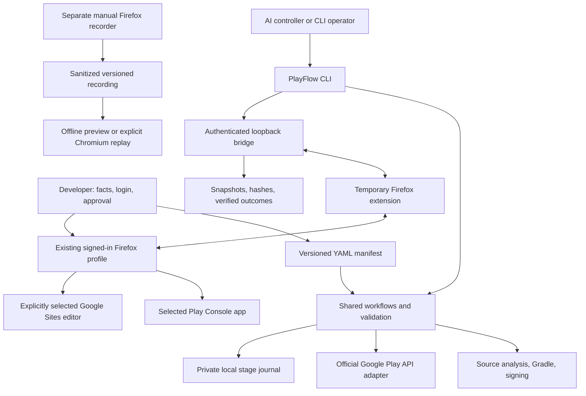

# PlayFlow: project guide and first complete submission field notes

Evidence date: October 18, 2026. Implementation examined: PlayFlow 0.1.0, early alpha. Audience: app developers, AI operators, contributors, and people evaluating the project without reading its source.

This guide explains what the tool does, how its parts cooperate, what the live publishing session taught us, what information was retained, and which parts can already be reused. It describes observed behavior separately from planned capabilities. Example account IDs, groups, paths, and contacts are placeholders; signing credentials and browser session tokens are deliberately absent.

## 1. What we achieved

We took a developer-owned Android TV remote utility from a local source project through build preparation, upload-key signing, privacy-policy publication, app declarations, store assets, closed-track configuration, bundle upload, and final Google Play review submission.

The final Console acknowledgement was **“15 changes sent for review.”** Publishing overview then showed **“Changes in review.”** We reopened the publishing page, required a new browser document, and verified that the status persisted. This establishes submission to Google. It does not establish Google's approval, tester availability, or production publication.

The developer estimated the interactive work at approximately 90 minutes. That is a user estimate, not an instrumented benchmark. The session combined tool development, environmental troubleshooting, app changes, material preparation, and actual submission. It should not be treated as the time every future app requires or as proof of a particular speedup.

The durable result is broader than a completed form: we now have an exercised workflow, a reusable Firefox connection, explicit facts and validation rules, several deterministic form workflows, release-signing safeguards, regression tests, and evidence of consequential transitions.

## 2. The problem PlayFlow solves

An Android source folder is only one input to Google Play publishing. A complete submission also needs the correct bundle and signing identity, accurate declarations, listing copy, image assets, privacy information, distribution settings, testers, and an explicit release decision.

These inputs come from different places. Gradle provides build configuration. The built AAB provides actual package identity and merged permissions. The developer provides product and data-practice facts. Google documentation provides external requirements. Play Console provides the actual account-specific workflow and remote state.

PlayFlow brings those inputs together so a developer or AI controller can prepare and execute the workflow consistently. Its core is a local Python CLI with versioned configuration. It has optional Google API and browser adapters. The installed tool does not contain an LLM or independently decide every next action; an AI can direct it through commands and structured results.

The current product is best described as **a publishing toolkit with a demonstrated supervised submission path**. A single command that autonomously completes every questionnaire for every Android app is a future capability.

## 3. The three execution paths

### Local preparation

Local commands read configuration, inspect trusted source projects, validate known inputs, invoke Gradle, select artifacts, sign release bundles, and record progress. Most preparation is independent of Google credentials.

### Official Google Play API

The API adapter handles edit creation, bundle upload, Google Groups updates, track changes, validation, and commit or discard. It needs an existing Play application, suitable service-account authorization, a package name, and an actual API track identifier. The adapter has offline test coverage; this particular submission did not exercise live service-account credentials.

Google's edit model separates temporary changes from a committed update. PlayFlow follows that model. **An API validation invocation still contacts Google and uploads the bundle**, even without `--commit`; it then discards the edit. See Google's [edits guide](https://developers.google.com/android-publisher/edits).

### Existing-session Firefox

The live integration used the developer's existing signed-in Firefox profile. A temporary extension connected it to a local authenticated server. The AI controller inspected controls, performed scoped actions, and verified results. This avoided creating another login session or restarting the browser for a debugging port.

The browser path was used for this app's declarations, listing, countries, groups, release upload, and final review submission. The official API remains the preferred architectural direction for operations it supports, once credentials and integration coverage are established.

## 4. Architecture in one view



The separation matters. A new AI integration can call the same CLI and workflow functions. A future browser implementation can replace the extension adapter without changing app facts or release-signing rules. Publishing logic should remain in shared workflows rather than being duplicated inside each agent.

## 5. A plain-language map of the project

| Component | Job | Important limit |
| --- | --- | --- |
| Manifest models and configuration | Validate app inputs and resolve project paths | Only implemented fields are supported; unknown fields fail |
| Android analyzer | Find likely package, SDK, permissions, dependencies, and build context | Static hints cannot establish every build variant or SDK behavior |
| Requirements and readiness | Check supported listing, image, declaration, and testing inputs | This is a documented subset, not a complete Google policy engine |
| Workflow layer | Coordinate local stages, policy gates, API operations, and approval | Does not yet orchestrate all browser questionnaires |
| Gradle and ADB adapters | Build trusted projects and install selected APKs | Local SDK, JDK, device authorization, and build compatibility are required |
| Signing and release preparation | Preserve upload identity, sign copies, back up credentials | Does not recover a forgotten password from encrypted key material |
| Google API adapter | Apply supported edit-based publishing operations | No live API integration was proven by the Firefox submission |
| Firefox profile discovery | Find and launch the intended existing profile | Opening a tab does not prove sign-in or completion |
| Live bridge and extension | Inspect and act within selected app/site scope | Custom widgets and changing labels may need controller work |
| Console setup workflows | Save and independently verify specific declarations | Currently privacy URL, ads, and no-advertising-ID branch |
| Attachment transport | Send only manifest-selected release files | Initial transport: 16 MiB per file, 64 MiB per session |
| Recorder and replay | Capture manual interactions and inspect/replay supported events | Separate from the live bridge; not an automatic workflow compiler |
| Stage journal | Record the latest stage attempt and result | No automatic resume, run-level provenance, or multiwriter coordination |

The implementation uses a standard `src/playflow/` Python package, with `tests/`, `docs/`, `examples/`, generated `schemas/`, packaging tools, contribution files, and CI alongside it.

## 6. What the screenshots were for

Two different kinds of screenshots were involved.

**Browser observation screenshots** helped the controller understand the current screen, identify dialogs, check layout, and operate browser-native controls that the extension could not reach. Examples include Firefox's temporary-addon picker and Google Sites rich-text editing. These images were diagnostic observations of a changing UI.

**App screenshots for the store** were genuine captures from the Android app running in an emulator. Those were listing deliverables. They were not generated mockups. We captured the remote and controls screens at a suitable resolution and converted the image encoding as needed.

A screenshot by itself is not a saved form, a reusable workflow, a policy fact, or a trained model. The session did not automatically train an AI on the images. The useful knowledge came from interpreting observations, checking official requirements, writing explicit logic, testing it, and retaining evidence of verified results.

Some desktop interactions used the current window position and keyboard shortcuts. Those were environment-specific helpers. The core Firefox form control uses semantic DOM information rather than a permanent list of cursor coordinates.

## 7. How the live Firefox bridge works

### Session creation

`playflow bridge-serve` loads the private manifest, derives the selected app's URL prefix, captures allowed upload files, creates a new random session token, and starts a server bound to loopback. It generates a private copy of the extension containing the connection configuration.

The operator loads that extension through Firefox's `about:debugging` page. The developer remains signed in through their own profile; PlayFlow does not export browser cookies into the project.

The distributable extension has credential-free configuration. The generated session copy and connection details live outside the source checkout on a filesystem that enforces private permissions. A small private project locator points to them. Restarting the server creates new connection details, so the newly generated addon must be loaded.

### Request and response

1. The CLI or controller sends an authenticated command to the local server.
2. The server validates the operation, app/site scope, write permission, fresh control reference, and any separate final-action permission.
3. The extension polls for the job and finds tabs matching the configured target.
4. Exactly one matching tab is required. Ambiguity stops execution.
5. The extension activates the selected tab, injects the content handler when necessary, and forwards the command.
6. The content handler validates the live page and control again, performs the allowed action, and returns a structured result.
7. The controller checks the result and, for important transitions, independently verifies the saved remote state.

Activating the tab was a practical reliability fix: Firefox can throttle background-tab timers. A background action might otherwise take too long to return its post-action snapshot.

### What an inspection returns

The snapshot contains the current URL and title, a new revision, a document identifier, visible headings, notices, recognized save acknowledgements, and a bounded list of controls. Controls include fields such as tag, role, accessible name, type, section, disabled state, value or checked state where appropriate, and a temporary ID.

File inputs expose upload metadata even when hidden, without turning them into ordinary editable fields. Known sensitive values are omitted. Other form values and account IDs can still be present, so snapshots remain private unless reviewed and sanitized.

Current snapshot limits include 400 controls, a 200,000-character control budget, bounded headings/notices, and truncated text values. A `truncated` result means the snapshot may be incomplete; it must not be treated as a complete page inventory.

Example, with invented identifiers:

```json
{
  "headings": ["Privacy policy"],
  "document_id": "document-identity",
  "truncated": false,
  "controls": [
    {
      "id": "snapshot-revision:12",
      "tag": "input",
      "name": "Privacy policy URL",
      "disabled": false,
      "value": "https://example.org/privacy"
    }
  ]
}
```

The revision ties controls to a particular inspection. The document identifier changes when the page document is replaced; that allows a workflow to distinguish a fresh reload from a snapshot of its own unsaved edits.

## 8. The action logic

Supported bridge operations are `inspect`, `navigate`, `click`, `fill`, `check`, native `select`, and the separate `attach` operation.

`fill` supports editable native input and textarea fields. It uses the native value setter and dispatches input/change events so the site's framework can observe the update. It checks the field's character limit. It does not implement arbitrary rich-text editing.

`check` compares the current state with the requested boolean. It clicks only when the state differs. This is safer than blindly toggling a checkbox that might already be correct. Native and ARIA checkbox/radio controls are supported within the implemented checks.

Native `select` requires a real select element and a known option value. Custom menus may instead expose clickable controls. Ambiguous names must be resolved using a fresh page inspection and context; the reusable Console helper refuses duplicate matches rather than choosing the first.

Each new snapshot invalidates old control IDs. The extension also checks that the element is connected, the page URL has not changed since the snapshot, the control is usable, and the command has not expired. Commands have a 25-second deadline. Only one command is active at a time.

There is no public command for arbitrary JavaScript execution, reading arbitrary local files, operating passwords, or bypassing the selected app/site boundary. These restrictions limit routine automation; they are not a guarantee that every future Console UI or every hostile web page has been accounted for.

## 9. Why an action response is not proof of completion

An early source of confusion was assuming that clicking Save or seeing Save become disabled meant Google's backend had persisted the answer. In practice, disabled controls can represent an in-flight request. Navigating too early can leave a change unsaved.

The reusable declaration workflows therefore use a stronger sequence:

```text
Open the expected form in a new document
→ verify heading and required field
→ compare saved-looking value with explicit manifest fact
→ change only if needed
→ click Save once
→ wait for a recognized save acknowledgement or saved/overview dialog
→ handle the dialog and wait for the form to settle
→ reopen the form in a new document
→ verify the configured value persisted
```

An attachment has a similar distinction: the browser receiving a File is separate from Google processing it, retaining it in the draft, and accepting the release. Final review submission has another: clicking Submit may only open a confirmation dialog.

The final submission in this session required a counted button and a confirmation. Only after the confirmation did Google show the sent-for-review notice. A new-document reload then confirmed the persistent in-review state.

## 10. Timeouts and recovery

A timed-out write has an unknown outcome. The action may have reached Google even if the client never received its response. Automatically repeating the action could duplicate an upload, toggle a setting, or submit a second operation against changed state.

The bridge does not automatically retry mutations. After an expired active command it requires inspection before another mutation. Reusable form code retries only narrowly recognized transient inspection errors while the page document is being replaced. The operator then reconciles what the current page actually shows.

The stage journal helps explain what was attempted. It does not make remote actions idempotent. If a process stops during API commit or browser submission, inspect Google before retrying.

Temporary addons disappear after Firefox restarts. After a server restart, load the new generated manifest; an old addon has obsolete credentials. A launch request, a connected bridge, a saved draft, and a submitted release are four different states.

## 11. The manifest: what information is reusable

`play-manifest.yaml` is the stable configuration contract. Pydantic validates it, rejects unknown fields and unsupported schema versions, and supports a generated JSON Schema for editors. The current schema version is 1.

| Configuration area | Stores | How it is used |
| --- | --- | --- |
| Project context | App name, source directory, optional repository and state directory | Select the correct project and journal location |
| Build | Module, Gradle task, explicit AAB/APK paths | Avoid selecting another module or variant by accident |
| Play | Package, actual API track, release status, rollout fraction, credentials environment variable | Parameterize supported API operations |
| Developer facts | Ads, advertising ID, login, audience, privacy/deletion URLs, review flag, support email | Gate operations and supply reviewed answers |
| Listing | Language, title, short and full descriptions | Validate and reuse listing copy |
| Assets | Icon, feature graphic, phone screenshots, AI label intent | Validate inputs and restrict attachments |
| Release notes | Language and text | Validate release-note lengths and prepare releases |
| Testing | Track intent, Google Groups, all/selected country intent | Plan Console setup and configure supported API groups |
| Browser | Engine, Firefox profile name/path, actual app URL | Reach the intended signed-in app |
| Approvals | Browser writes and final-submit approval requirement | Bound remote mutations |

Project paths resolve relative to the manifest. Asset paths resolve against the selected Android project. An explicit Firefox profile path takes precedence over a profile name. The journal directory can be relocated beside a manifest instead of inside the Android checkout.

Some facts gathered during this integration live only in private progress evidence rather than typed manifest fields. For example, the current manifest does not encode the full IARC questionnaire, every health or financial branch, or a complete structured Data safety inventory. A `data_safety_reviewed` flag records a review decision; it is not the underlying questionnaire or proof of data practices.

The difference between missing and negative matters: `contains_ads: null` means unknown; `false` means explicitly no ads. For AI asset labels, `null` means unreviewed, `[]` means reviewed with no applicable assets, and a list identifies the assets needing labels.

## 12. A portable configuration example

This example illustrates supported fields, not a ready-to-submit declaration for an arbitrary app. Replace placeholders, validate the real project, and review the facts first.

```yaml
schema_version: 1
app_name: Example Remote
project_dir: ../ExampleRemote
state_dir: .playflow/example-remote
build:
  module: app
  gradle_task: bundleRelease
  aab_path: app/build/outputs/bundle/release/app-release.aab
play:
  package_name: com.example.remote
  default_track: null
  release_status: draft
browser:
  engine: firefox
  firefox_profile_name: Normal
  console_url: https://play.google.com/console/u/0/developers/123/app/456/app-dashboard
developer_facts:
  contains_ads: false
  uses_advertising_id: false
  login_required: false
  target_audience: General teen and adult household users
  privacy_policy_url: https://example.org/privacy
  support_email: support@example.org
  data_safety_reviewed: false
listing:
  - language: en-US
    title: Example Remote
    short_description: Infrared controls for compatible televisions
    full_description: Requires a phone with an infrared transmitter. Compatibility varies.
assets:
  icon: store/icon.png
  feature_graphic: store/feature-graphic.png
  phone_screenshots:
    - store/phone-01.png
    - store/phone-02.png
  ai_generated: []
release_notes:
  - language: en-US
    text: Initial closed test.
testing:
  mode: closed
  google_groups:
    - first-testers@googlegroups.com
    - second-testers@googlegroups.com
  country_scope: all
  countries: []
approvals:
  require_final_submit_approval: true
  allow_browser_write_actions: false
```

Leaving `default_track` null is intentional until the API identifier is known. The numeric track ID in a Console URL, a displayed label such as Alpha, and the API track identifier must not be treated as interchangeable. This browser submission did not resolve the API identifier.

## 13. What preflight checks today

The implemented requirements subset is versioned as `2026-10-18.1`. Requirements should be rechecked when Google changes its rules, with corresponding validator and schema updates.

| Input | Current implemented check |
| --- | --- |
| App title | Maximum 30 characters |
| Short description | Maximum 80 characters |
| Full description | Maximum 4,000 characters |
| Release notes | Maximum 500 Unicode characters per language |
| Store icon | 512 × 512, RGBA PNG, no more than 1,024 KB |
| Feature graphic | 1024 × 500, RGB JPEG or PNG, without alpha |
| Phone screenshots | 2–8 distinct files; supported RGB encoding; dimensions 320–3840; longest side at most twice shortest |
| Bundle | Configured or unambiguously module-selected AAB exists |
| Groups | Email syntax, normalization and deduplication |
| Countries | Explicit all, or selected with nonempty two-letter codes |
| Track | Actual identifier required for API operations; closed intent cannot silently use internal/production |
| Contact and labels | Explicit public support email and reviewed asset-label intent |

Listing limits are documented in Google's [app setup guide](https://support.google.com/googleplay/android-developer/answer/9859152); release notes in its [release preparation guide](https://support.google.com/googleplay/android-developer/answer/9859348). Image dimensions, encodings, and the general screenshot constraints are documented in [preview asset requirements](https://support.google.com/googleplay/android-developer/answer/9866151).

The implemented validator covers phone screenshots. Other form factors need dedicated rules. It does not judge whether the images are truthful, visually effective, properly licensed, or acceptable under every content rule.

`preflight` runs offline without launching a browser, building, contacting Google, or writing workflow state. It returns a report and exits 2 while inputs or manual verification remain. It does not verify a bundle signature, decode actual package identity, or certify completed Console questionnaires. A remote app can be submitted through the browser while an API-specific preparation item, such as an unresolved API track identifier, remains in the local report.

## 14. Build, artifact identity, and signing

The source analyzer is conservative. It reads standard Android XML and static Gradle expressions, prefers a literal application ID, and flags ambiguity. Namespace alone does not establish the release package. Flavor suffixes, dynamic expressions, custom project-directory mappings, and merged dependencies require additional handling or explicit configuration.

Artifact selection is scoped to the configured module. If several matching bundles exist, the operator must select one explicitly; the tool does not choose whichever unrelated output was modified most recently.

A debug APK from `assembleDebug` is a development artifact. The Google Play workflow here used a signed Android App Bundle from `bundleRelease`. A successful Gradle build, a valid JAR signature, the expected package/version, actual runtime behavior, and Google acceptance are separate checks.

Signing uses JDK tools. PlayFlow generates a key only when requested, refuses to overwrite an existing identity, signs a copy rather than changing the source bundle, and strictly verifies that copy. Passwords are supplied through private file references rather than literal command-line values.

`finish-release` verifies and backs up signing material, builds the configured bundle, signs it, and updates the private manifest to select the result. It does not upload. Its `--open-console` option requests a Firefox tab afterward; opening a page does not fill forms.

The session exposed an earlier missing-password problem. The durable fix was persistent private backups, verified recovery against the same certificate, and explicit recovery rules. `--recover-unused-key` applies only to a key that has never been uploaded or registered. It must never be used as a general repair for a registered upload identity.

After Google accepted this upload, we recorded that registration locally with `signing-record-upload`. The persistent registration marker prevents the unused-key recovery path from replacing that certificate, even if an older descriptor is restored. The command records a confirmed fact; it does not query Google.

During this integration we also ran bundletool separately to validate the actual AAB and inspect package/version/permissions. That was live integration verification, not an automatic capability of the general `sign-bundle` or `preflight` commands.

## 15. How attachments are handled

At bridge startup, PlayFlow reads only explicitly selected files: the configured bundle, icon, feature graphic, and phone screenshots. It validates supported image/AAB structure and captures immutable bytes plus filename, MIME type, size, and SHA-256 hash.

Commands reference asset IDs such as `bundle`, `icon`, `feature_graphic`, and `phone_screenshots.0`. They do not accept an arbitrary filesystem path. The extension checks the size and hash, creates a browser File, assigns it to the intended file input, and dispatches upload events.

Uploads are allowed only to the selected Play Console app, not the Sites editor. Password files, keystores, and other arbitrary local files are outside the asset selection interface. Bridge status reports metadata without file bytes or local asset paths.

The initial transport holds files in memory and encodes them for delivery. Its limits are 16 MiB per file and 64 MiB total per session. These are PlayFlow implementation limits, not Google's bundle-size limits. A larger app requires another upload path or a future streaming transport.

Changing a file on disk does not change the bytes already captured for a session. Restart the bridge after selecting another build or modifying an asset, then verify the new hashes. After attaching, still wait for Google's processing, save, and reopen the relevant form or release to check persistence.

## 16. The actual app used to test the process

The app was Smart Universal TV Remote, a native Kotlin Android project with package `com.cybersight.panasonicremote`, version name `0.2.0`, and version code `3`.

Observed integration configuration:

| Item | Observed result |
| --- | --- |
| Android build stack | JDK 17, Gradle 8.13, AGP 8.11.1, Kotlin 2.2.21 |
| SDK | Compile/target 36; minimum 23 retained |
| Build checks | Debug APK, release bundle, and debug lint completed |
| Bundle inspection | Actual package/version checked; only `android.permission.TRANSMIT_IR` reported |
| Emulator | API 36.1; UI and offline privacy dialog checked |
| Phone assets | Two real 1080 × 1920 RGB screenshots |
| Browser | Firefox 157 with the developer's existing Normal profile |
| Store category | Tools |
| Access and monetization | Developer confirmed no login and no ads |
| Data practices | Developer confirmed no collection/sharing; inspected app and actual permissions supported this path |
| Target audience | 13–15, 16–17, and 18+, chosen for this general household utility under delegated product judgment |
| Test scope | Closed testing; two Google Groups; 177 available country/region rows plus Rest of world |
| Final outcome | 15 changes submitted; in-review status verified after a fresh document load |

The phone sends infrared commands; it is not an Android TV application merely because “TV” appears in its name. Physical infrared operation and compatibility with real televisions were not proven in the emulator. The selected age groups describe intended audience, not an IARC content-rating result and not a universal recommendation for remote-control apps.

## 17. The complete workflow that was exercised

1. **Identify the correct source project.** Confirm source folder, app identity, build configuration, and the desired submission target. Do not reuse an unrelated Console app merely because it is already open.
2. **Collect developer facts.** Confirm ads, login, data practices, contact, target audience intent, tester groups, and country scope. Save reusable values; retain unresolved questions explicitly.
3. **Prepare the Android release.** Resolve toolchain issues, build and lint, add an accessible offline privacy experience, and verify layout changes in the emulator.
4. **Prepare listing materials.** Write bounded descriptions, render the existing icon into the required store format, prepare the feature graphic, and capture real app screens.
5. **Prepare and publish the privacy policy.** Describe the actual app, local preferences, backup behavior, IR capability, and contact. Publish the selected Google Site and check the public URL without relying on the logged-in editor.
6. **Open or create the matching Console app.** Verify app identity and scope the browser bridge to that actual app path. Initial app creation was supervised, not a reusable create-app command.
7. **Complete setup declarations.** Privacy, app access, ads, content rating, target audience, Data safety, government, financial, health, category/contact, and listing were completed for the observed branches.
8. **Apply and verify store assets.** Attach the four selected image assets, apply individual asset provenance labels, save, and reopen the listing to check retention.
9. **Configure the closed track.** Select all available countries/regions including Rest of world, enter both Google Groups, save, and reopen to verify.
10. **Upload and inspect the release.** Attach the exact signed AAB, resolve blocking processing issues, verify the accepted version, and save release notes.
11. **Complete upload-triggered requirements.** The advertising-ID declaration appeared during the post-upload checks. Complete and verify it using the actual app facts.
12. **Review Publishing overview.** Check errors, warnings, pending changes, and managed publishing behavior. Distinguish staged changes from submitted changes.
13. **Get final approval.** Present the prepared release and declaration facts. The configuration required approval, so the workflow stopped at that boundary until the developer said yes.
14. **Submit and verify.** Enable the bounded permission, click the counted submission button and its confirmation, observe Google's acknowledgement, reopen the page in a new document, and record the in-review state.

The ordering is evidence from this app, not a promise that every account will show exactly these screens in the same order. Console tasks can be conditional, and a first upload can reveal additional requirements.

## 18. Problems encountered and the reusable lessons

### Build environment restrictions

Earlier execution hit a local-socket restriction before Java could compile. Android Studio or a normal terminal could build outside that restriction. Later integration builds ran successfully in the available environment. The lesson is to distinguish an execution-environment failure from a source compile error, and preserve a build/sign separation so an externally built unsigned bundle can be signed locally.

### Firefox profiles were not all in profiles.ini

The desired Normal profile was registered in Firefox's newer profile-group SQLite structure. Discovery now reads both legacy registration and the profile-group databases in read-only mode. Unknown or ambiguous profile names fail rather than silently falling back to another signed-in account.

### A built bundle did not open Firefox automatically

The original release-finishing script built and signed only. Browser launching became explicit through `open-console` or `finish-release --open-console`. This makes command outcomes understandable: successful signing does not imply browser automation has started.

### Screenshots had the wrong aspect ratio

An initial 1080 × 2400 capture exceeded the implemented 2:1 longest-to-shortest limit. We recaptured the real UI at 1080 × 1920 and verified supported image encoding. Resolution alone is insufficient; aspect ratio and color mode also matter.

### Modern target SDK exposed an app layout issue

The project moved to an API-36-compatible toolchain. We checked the app in an emulator, corrected the root layout's system-window handling, rebuilt, and captured updated images. The exact layout choice belongs to this app; the general lesson is to run the upgraded build and inspect the experience before preparing store assets.

### Automatic protection blocked minimum SDK 23

Google's optional automatic protection has an API-24 prerequisite. For this closed test, the installer check was turned off and the saved setting verified so minimum SDK 23 support could remain. Play App Signing remained enabled. These are different features. Disabling protection is an app-specific decision, not a general automation default. See Google's [automatic protection documentation](https://support.google.com/googleplay/android-developer/answer/10183279).

### No ads and no advertising ID are different answers

A library can use advertising ID independently of whether the app visibly shows ads. The developer's statement, dependency inspection, and actual bundle permissions supported No for this app. The reusable workflow supports that reviewed No branch; Yes requires purpose declarations that are not implemented there. Google's [advertising-ID guidance](https://support.google.com/googleplay/android-developer/answer/6048248) explains the permission and SDK relationship.

### Asset provenance was a separate declaration

The feature graphic was labeled AI-assisted. The icon conversion and genuine emulator captures were not labeled as generated imagery. The manifest records per-asset intent, and the remote listing declaration was completed separately. Google documents the [individual asset declaration](https://support.google.com/googleplay/android-developer/answer/17262077).

### A warning was not a blocking error

The release had a deobfuscation-file warning. The build was not minified, so there was no R8 mapping file to upload. The release review had no blocking errors. The lesson is to classify each warning against actual build behavior rather than inventing a file or repeatedly rebuilding.

### Google Sites editing and publishing were separate

Filling the editor did not make a policy public. Rich-text editing required desktop keyboard interaction; publication used the scoped bridge permission. We verified the public HTTP response and its app/contact content. The offline app policy and public policy described consistent practices.

### Account-specific geography should not be hardcoded

“All countries” meant every available row in that live Console, plus Rest of world. The observed count was 177 country/region rows, not a permanent global constant. Google Groups configuration did not enroll anyone or manage group membership.

## 19. Final-action approval is separate from form editing

`allow_browser_write_actions: true` enables ordinary scoped mutations. It does not authorize final publication. The manifest's final-submit approval requirement remains a separate decision.

For Google Sites, `--site-url` explicitly adds the chosen editor. After the user approves publication, `--allow-site-publish` allows up to two exact Publish clicks for the editor/review sequence. This permission does not authorize a Play submission.

For Play review, after explicit approval of the prepared changes, `--approved-review-changes <count>` permits one matching counted Submit/Send-for-review action on the selected app's Publishing overview, followed by one uncounted confirmation if shown. Other counts/pages, repeated counted submissions, rollout, and deletion remain blocked by this interface.

The first tested submission used 15 as the observed count. That value must be obtained again for another release. It is not a hardcoded release size. Permissions end when consumed or the server session stops.

The operator is responsible for enabling that permission only after genuine approval and only for the reviewed state. It is a bounded command permission, not a cryptographic proof that every remote field remained unchanged. A future durable approval record should bind configuration, artifact hashes, and a captured change summary.

Managed publishing was off in this integration, so the developer was told that the closed release could become available after Google approves. No production rollout was performed.

## 20. Data and evidence retained from the session

| Evidence type | What it contains | Why it is useful |
| --- | --- | --- |
| Private manifest | Reusable app inputs and approved facts | Avoid repeatedly asking for unchanged information |
| Analyzer output | Source-derived package/build/permission hints | Find gaps and guide artifact verification |
| Signed bundle metadata | Filename, hash, public certificate fingerprint | Identify which exact release was selected |
| Bundle verification record | Actual package, version, SDK and permission inspection | Separate built identity from source guesses |
| Store assets | Validated icon, graphic, genuine app captures | Reuse or update publication materials |
| Browser snapshots | Structured controls, headings, notices, document identity | Explain screen state and verify transitions |
| Privacy publication proof | Public URL, observed content/status and time | Show publication beyond the authenticated editor |
| Console progress | Saved declarations, groups/country scope, release and review status | Make the completed remote path inspectable |
| Submission confirmation/results | Confirmation screen and persistent in-review snapshot | Establish that submission actually happened |
| Stage journal | Latest running/done/blocked/failed stage entries | Diagnose interrupted or failed attempts |
| Offline tests | Regressions for gates, protocol, schemas, signing and adapters | Preserve behavior learned during integration |
| Distribution checks | Reviewed source/wheel contents and checksums | Reduce accidental inclusion of private runtime data |

Most integration artifacts live under a private `.playflow/<app>/` area. Persistent signing backups and session configuration live outside the checkout. Exact local paths are machine-specific and are not part of the public interface.

Not every diagnostic screenshot was consolidated into an indexed archive. Some were transient files in `/tmp`; they should not be relied on as permanent evidence. The durable lessons are represented by code, tests, this guide, sanitized examples, and private structured records. A future evidence index could associate each important observation with its workflow step and input hashes.

Public certificate fingerprints and bundle hashes are not passwords, but private snapshots can contain names, email addresses, account IDs, and app details. Do not publish raw runtime state merely because its known secret fields were redacted.

## 21. What is already reusable and what still needs an AI controller

| Capability | Current maturity |
| --- | --- |
| Configuration validation and editor schema | Reusable CLI functionality |
| Static project inspection and module-scoped artifact selection | Reusable, with documented static-analysis limits |
| Listing and supported phone-asset preflight | Reusable offline validation |
| Gradle build, ADB install, standalone signing and release finishing | Reusable local adapters; environment/project compatibility still matters |
| Firefox profile discovery and launch | Reusable for supported Firefox registration formats |
| Scoped semantic browser actions and selected-file attachment | Reusable bridge primitives |
| Privacy URL, ads, no-advertising-ID declaration | Reusable save-and-reopen workflows with English labels |
| Other content declarations and IARC branches | Completed in this session through supervised inspection/actions; not a full reusable catalogue |
| App creation, full listing, countries and tester-group UI orchestration | Exercised here; generalized workflows remain to be built |
| Final browser review submission | Reusable bounded permission/action mechanism; still requires prepared-state review and result inspection |
| Google API publishing and group merging | Implemented and tested offline; live credentials/integration still need validation |
| Automatic workflow compilation from screenshots/recordings | Not implemented |
| Automatic resume and remote reconciliation | Not implemented |
| Google review approval, production access, physical IR operation | Outside the completed submission evidence |

This is why another similar app should require less discovery work, yet “just run one command” is not an accurate description of the complete onboarding experience today. Speed improvement is a reasonable expectation from reuse; its magnitude has not been measured.

## 22. Command and option reference

Most app commands accept `--manifest /path/to/play-manifest.yaml`. Run `playflow <command> --help` for the installed version's complete syntax.

| Command | Purpose and notable options | Remote or consequential behavior |
| --- | --- | --- |
| `init` | Create manifest; `--app-name`, `--output` | Writes local configuration |
| `inspect` | Inspect selected source project | Local source reading and journal update |
| `policy-check` | Report unresolved implemented developer facts | Does not certify compliance |
| `preflight` | Offline preparation report | No browser, build, Google call, or journal write |
| `testing-plan` | Show intended groups/countries/track preparation | Offline plan |
| `build` | Run configured Gradle task | Executes trusted local project scripts |
| `signing-init` | Generate a new local upload identity; optional `--password-file` | Never replace an existing key casually |
| `sign-bundle` | Sign a copy; `--aab`, `--output` | Local JAR-signature verification |
| `finish-release` | Verify/back up key, build, sign, select artifact; `--open-console`, restricted `--recover-unused-key` | No upload or submission |
| `signing-record-upload` | Record confirmed certificate registration using its full fingerprint | Local safeguard; does not query Google |
| `adb-install` | Install selected APK; `--serial` for explicit device | Changes the chosen device |
| `firefox-profiles` | Discover registered profile names and paths | Read-only profile registration inspection |
| `open-console` | Request existing-profile tab; URL/profile overrides | Launch request only |
| `bridge-serve` | Start scoped bridge; `--site-url`, `--allow-site-publish`, `--approved-review-changes` | Final-action flags require separate prior authorization |
| `bridge-status` | Show connection, scope, upload metadata and remaining permissions | Does not establish saved Console state |
| `console-inspect` | Return current structured snapshot; optional `--target` | Read-only within session scope |
| `console-action` | Operation plus fresh `--control-id`, `--value`, optional `--target` | Ordinary mutations need manifest write permission |
| `console-attach` | Asset ID and fresh file-input ID | Sends only captured selected release assets |
| `console-setup` | `privacy`, `ads`, or `advertising-id`; `--apply` to execute | Preview default; apply saves and verifies supported branch |
| `configure-testers` | Merge configured groups through API; `--commit` | Default validates then discards a real remote edit |
| `publish` | Upload selected bundle; `--track`, `--commit` | Default is remote validation, not offline preview |
| `run` | Inspect, policy gate, build; optional `--publish`, `--commit` | Does not complete all browser forms or implicitly sign |
| `auth`, `browser-doctor` | Dedicated Chromium authentication/check | Separate from existing-session Firefox bridge |
| `replay-recording` | Recording path; `--allow-write`, `--max-events` | Offline preview default; live replay uses Chromium and explicit permission |
| `state` | Read current private stage journal | Does not resume execution |

`--commit` on `run` requires `--publish`. API commits use the shared configured approval gate. An embedding application must supply approval when required; calling a lower-level CLI alternative must not silently bypass the gate.

## 23. A realistic operator runbook

### Prepare the local tool and app

```bash
python3 -m venv .venv
source .venv/bin/activate
python -m pip install -e .
playflow --help
```

Python 3.11 or later is required. Android builds also need a compatible JDK, Android SDK, and trusted project wrapper. ADB is optional unless testing/installing on a device. Linux is the primary verified environment.

From the Android project root, create and edit a private manifest, then inspect it:

```bash
playflow init --app-name "My App"
playflow inspect
playflow policy-check
playflow preflight
playflow testing-plan
```

Supply missing facts and assets, resolve build variants, and preserve the correct upload key. If release signing is not configured in Gradle, follow the signing guide; initialize only when no existing identity must be reused, then run the appropriate build/sign command.

### Use the Firefox connection

```bash
playflow firefox-profiles
playflow open-console
playflow bridge-serve
```

Configure the exact profile and actual app URL before starting the bridge. Load its printed temporary manifest through `about:debugging`. Keep the server running, and use a second terminal:

```bash
playflow bridge-status
playflow console-inspect
playflow console-setup privacy
playflow console-setup ads
playflow console-setup advertising-id
```

Those setup commands preview by default. After reviewing facts and enabling browser writes in the private manifest, add `--apply` for a supported form. Use fresh IDs for manual actions and attachments; never reuse IDs copied from an old snapshot.

### Complete the release with a controller

The AI or operator handles remaining declarations, listing, groups, countries, and release screens through inspection and explicit actions. Check remote saves and uploaded version identity. Review the final pending-change set, resolve blockers, explain managed publishing behavior, and obtain the configured final approval.

Only then restart the bridge with `--approved-review-changes <actual-count>`, load that session's generated addon, and execute the matching final action and confirmation. Inspect the resulting Google status and verify persistence. Do not assume that starting the server with the flag automatically submits anything.

### If choosing the official API instead

Install the publish extra, configure a service-account credential file outside the repository through the named environment variable, resolve the actual API track identifier, and review the target track. `publish` without commit validates a real upload and deletes the edit; `publish --commit` commits after the configured approval. This route does not substitute for initial Console app setup or every policy declaration.

## 24. Recorder, replay, and live bridge are different tools

The standalone Firefox recorder captures selected manual interactions into a versioned JSON format. It strips URL query/fragment data, skips known sensitive controls, avoids whole-page text capture, and binds to one tab. Its output still needs review before sharing because ordinary field values and account paths can remain.

`replay-recording` can preview that file offline without opening a browser. Explicit write replay currently uses the separate Playwright/Chromium adapter, not the existing Firefox bridge. It supports a restricted set of semantic actions, stops on failures or ambiguity, and does not replay arbitrary scripts, login flows, or file uploads.

The live bridge instead accepts fresh requests against the current signed-in Firefox page. A recorder export is not required for it to work. The project does not yet compile raw screenshots or recordings into a durable complete workflow automatically.

## 25. Policy facts: what AI may infer and what needs review

Use different evidence standards for different claims:

1. **Source hint:** an ad SDK or permission was found in project files. This is a reason to investigate, not a complete declaration.
2. **Artifact fact:** the selected built bundle declares a particular package, version, or permission. This is stronger technical evidence for that artifact.
3. **Developer statement:** whether an account exists, data leaves the device, a service is government-affiliated, or a feature is intended for children. Preserve the explicit statement and review against the actual product.
4. **External requirement:** Google's current documented rule. Keep its source and verification date.
5. **Remote observation:** Google saved a field, processed a bundle, or changed submission status. Verify independently of the action request.

No network permission does not prove every possible data-handling claim for every app. A category does not determine every questionnaire branch. “A child could use it” does not establish that children are the intended target audience. The target-age decision in this session was delegated and app-specific; it must not become a shortcut for avoiding relevant requirements.

A future rules engine should combine ads, accounts, SDKs, permissions, data practices, audience, feature categories, form factor, developer/account context, and track requirements. The current code implements a limited explicit gate, not that complete engine.

## 26. Security and open-source boundaries

The public repository should contain portable code, tests, examples with invented values, requirement references, and documentation. Keep actual manifests, account-specific snapshots, recordings, browser profiles, signing material, passwords, and service-account files private.

The bridge uses per-session authentication, Host/Origin checks, loopback binding, app/site scoping, fresh control IDs, deadlines, and independent checks in Python and the extension. Firefox host permissions are broader than a single app path; the narrower app boundary is enforced by the protocol layers. These measures reduce accidental actions but do not replace a full security audit.

Private POSIX permissions matter. The project disk in this environment did not reliably enforce requested private modes, so durable credentials and generated token-bearing configuration were placed on a private home filesystem. An ignore rule prevents common accidental commits; it does not make a world-readable secret private or sanitize repository history.

Gradle projects and wrappers are executable code. Use trusted source. Google credentials and browser sessions give real account authority. Restrict access to the intended app and keep final decisions explicit.

The package already has MIT licensing, contribution/security guidance, an explicit `src/` layout, schema validation, sanitized examples, source/wheel packaging, and CI configuration. This preparation reduces later restructuring. It does not mean the repository or package has already been publicly published, the package-index name is available, or a private vulnerability-reporting route is configured.

## 27. Tests and distribution evidence

The last implementation check before submission passed **139 Python tests and 16 JavaScript tests**, along with Ruff and schema drift checks. The tests cover implemented logic and mocked adapters; they do not run Google's live review process.

Coverage includes configuration validation, artifact ambiguity, policy/approval gates, API ordering and cleanup, atomic state, signing preservation and registered-key recovery refusal, browser scoping, sensitive fields, deadlines, final-action permissions, selected-file integrity, and declaration save verification.

Source and wheel archives were built and inspected. Checks reject known private/generated directories and credential patterns, require expected extension assets, and verify that distributed bridge configuration contains no session credentials. An installed-wheel smoke check was performed outside the source checkout. General packaging rules cannot detect every secret renamed to an innocent filename.

The CI configuration tests Python 3.11–3.14, uses Node 22 for JavaScript regressions, checks lint/schema drift, and builds distributions. A configured matrix is not evidence that every hosted CI job has run successfully for a public repository. Real Android/Firefox/Console integration remains a separate evidence category.

## 28. How future runs can become faster

The main opportunity is to turn discovery work into deterministic workflow modules. The first session had to discover registration formats, UI states, save timing, attachment constraints, upload-triggered declarations, and actual final-confirmation behavior. Repeating that discovery for every app wastes time and increases inconsistency.

Reusable configuration already eliminates repeated entry of stable facts, groups, listing materials, and selected artifacts. Local preflight catches predictable failures before a browser upload. Semantic control inspection reduces dependence on screen coordinates. Save-and-reopen verification reduces uncertainty about completed tasks. Artifact hashes make exact upload selection reviewable.

The remaining speed work is to encode the exercised listing, countries, groups, content-rating, and other declaration branches as explicit workflows, with clear expected screens and completion evidence. Add input fingerprints and remote reconciliation before claiming automatic resume. Measure preparation, build, upload, interaction count, and recovery time separately on subsequent apps before advertising a speedup.

Google build processing, human authentication, unanswered product facts, hardware testing, and Google's review remain external to any claimed automation timing. Submitting faster does not make Google review faster.

## 29. Priorities for contributors

1. Generalize the supervised listing/assets/countries/groups path into tested workflows above the existing bridge primitives.
2. Introduce a typed questionnaire catalogue and branching rules with provenance, reviewed facts, and explicit unknown states.
3. Integrate actual AAB identity/permissions verification as a reusable pre-upload command rather than relying on session-specific bundletool work.
4. Validate official API adapters against a developer-owned app with restricted service-account permissions, including uncertain commit outcomes.
5. Introduce a versioned run model with input/artifact fingerprints, concurrency control, durable approval records, and remote reconciliation before automatic continuation.
6. Support larger bundle transport, more device-form-factor assets, localization, and changed Console labels through explicit compatibility work.
7. Add sanitized integration fixtures and benchmark repeated runs. Preserve the distinction between event dispatch, saved remote state, submission, and approval.

These are proposed priorities derived from the implementation and field session. They are not promises of completed features.

## 30. Reading map and evidence sources

For the local project, start with `README.md`, then `docs/architecture.md`, `docs/firefox-bridge.md`, `docs/readiness.md`, `docs/signing.md`, `docs/integration-notes.md`, `docs/roadmap.md`, and `docs/releasing.md`. Review `examples/closed-testing.yaml` and `schemas/play-manifest.schema.json` for the current configuration contract.

Implementation evidence for this guide came from `models.py`, `config.py`, `analyzer.py`, `requirements.py`, `readiness.py`, `workflow.py`, `play_api.py`, `firefox.py`, `bridge.py`, `console.py`, `attachments.py`, `signing.py`, `release.py`, `state.py`, the packaged extension, CLI help/signatures, tests, packaging checks, and private integration records. Those records were used as evidence and were not copied into the public guide.

The earlier Notion research describes the intended hybrid architecture. Its automatic-resume language and preference for an initial internal-test/Playwright path should be read as design intent. The actual demonstrated path used existing-session Firefox and closed testing. The current journal is not resumable, and full questionnaire automation is still being built. This guide records the implementation and first verified submission, without replacing the earlier research history.

External requirements cited above were checked against official Google pages during preparation of this guide. They are dated knowledge; future changes need source verification. The durable engineering principle is to preserve explicit app facts, scoped actions, and independent evidence of remote outcomes as the UI and policy requirements evolve.
